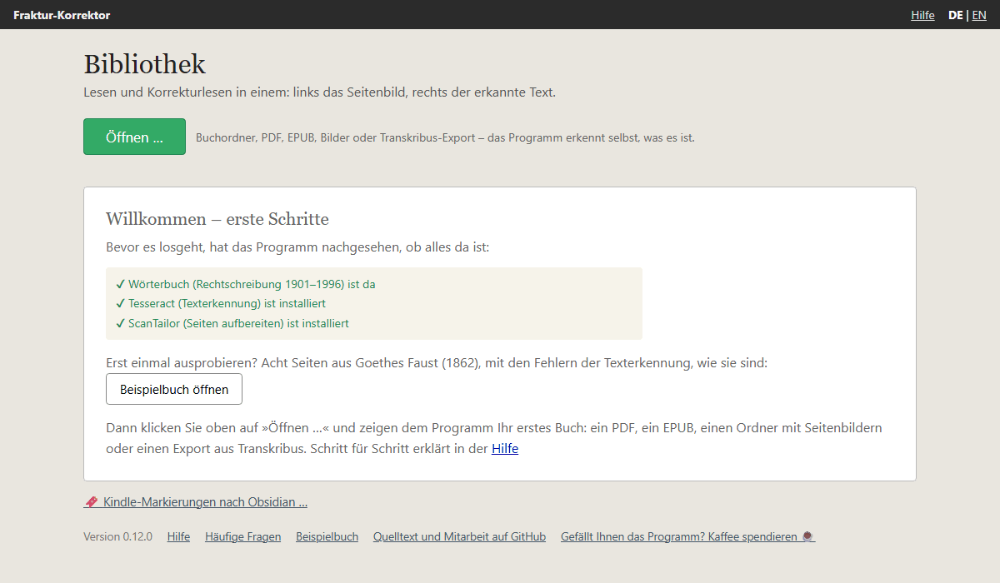
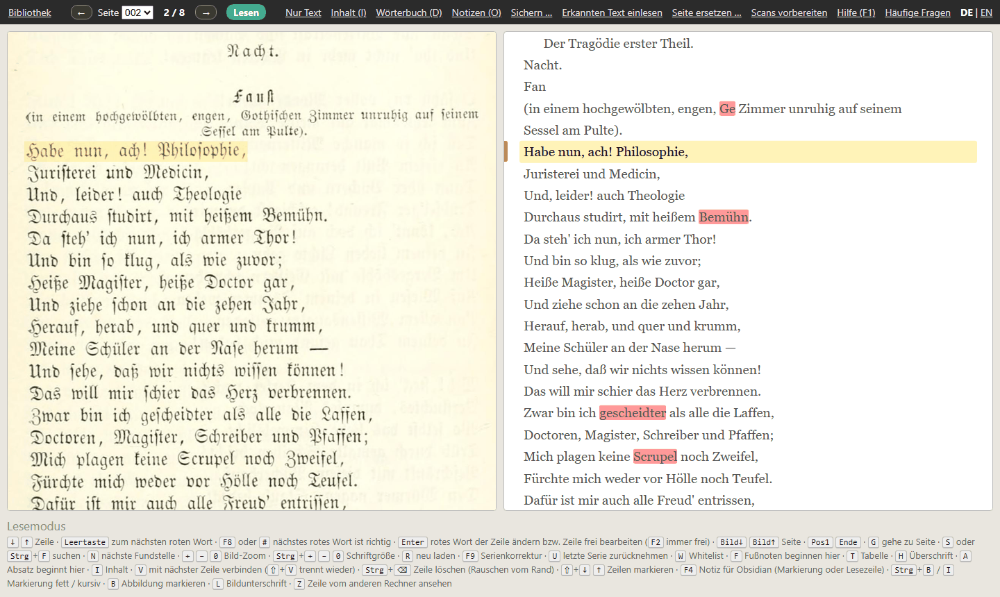
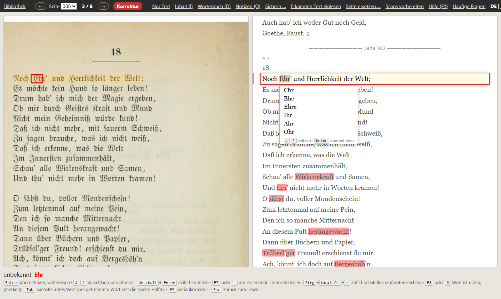

# Erste Schritte

Diese Seite führt Sie in zehn Minuten durch das Wichtigste – an einem Beispielbuch, das dem Programm beiliegt. Sie
brauchen dafür kein eigenes Buch und können nichts kaputt machen.

## Das Beispielbuch öffnen

Beim ersten Start zeigt die Bibliothek einen Willkommensgruß. Darin hat das Programm schon nachgesehen, ob alles da
ist, was es braucht – drei grüne Haken. Darunter steht der Knopf **Beispielbuch öffnen**.

Das Beispielbuch sind acht Seiten aus Goethes *Faust* in einer Ausgabe von 1862: das Titelblatt, der Anfang des
Monologs »Habe nun, ach! Philosophie …« und drei Seiten Prosa. Der Text ist so, wie ihn die Texterkennung geliefert
hat – mit ihren Fehlern. Das Programm legt eine Kopie in Ihrem Bücherordner an; was Sie darin ändern, betrifft nur
diese Kopie. Später finden Sie das Beispielbuch in der Bibliothek wieder, und unten in der Bibliothek steht immer
der Link **Beispielbuch**.

## Was Sie sehen

- **Links das Seitenbild**, so wie das Buch gedruckt ist.
- **Rechts der Text**, den die Texterkennung daraus gemacht hat.
- **Die gelbe Lesezeile** steht in beiden Hälften auf derselben Zeile. Bild und Text wandern gemeinsam, wenn Sie
  weiterlesen.
- **Rote Wörter** kennt das Wörterbuch nicht. Das heißt nicht immer, dass sie falsch sind – dazu gleich mehr.
- **Unten** stehen die Tasten, die gerade gelten. Sie müssen sich also nichts merken.
- **Oben in der Leiste** steht, in welchem Zustand das Programm ist: **Lesen** (grün) oder **Korrektur** (rot).

## Lesen

Drücken Sie `↓`, und die Lesezeile rückt eine Zeile weiter; `↑` geht zurück. Das Mausrad tut dasselbe, und ein Klick
auf eine Zeile macht sie zur Lesezeile. Am Ende einer Seite geht es ohne Halt auf der nächsten weiter. Ganze Seiten
blättern Sie mit `Bild↓` und `Bild↑`.

## Ein rotes Wort berichtigen

Drücken Sie die `Leertaste`. Das Programm springt zum nächsten roten Wort, und die Anzeige oben wird rot:
**Korrektur**. Die Zeile wird zum Eingabefeld, das Wort ist markiert, und im Seitenbild ist es rot umrahmt – so sehen
Sie auf einen Blick, was dort wirklich gedruckt steht.

Jetzt gibt es drei Möglichkeiten:

1. **Das Wort ist falsch erkannt.** Tippen Sie einfach das richtige Wort – es ersetzt das markierte. Oder wählen Sie
   mit `↓` einen der Vorschläge darunter. `Enter` übernimmt die Berichtigung. Gespeichert ist sie damit schon; einen
   Knopf zum Speichern gibt es nicht.
2. **Das Wort ist richtig**, nur kennt das Wörterbuch es nicht – ein Name, ein Fachwort, eine alte Schreibung.
   Drücken Sie `F8`. Das Programm merkt sich das Wort für dieses Buch und markiert es nirgends mehr rot.
3. **Sie wollen es sich später ansehen.** `Esc` bricht ab, ohne etwas zu ändern.

Im Bild oben ist es Fall 2: »Ehr'« ist Goethes Kurzform für »Ehre«, also richtig – `F8`. Auf der Seite davor steht ein
echter Fehler: Aus »gothischen« hat die Texterkennung »Ge« gemacht. Probieren Sie es dort aus.

Nach `Enter` oder `F8` steht das Programm wieder im Lesen – es sei denn, in derselben Zeile ist noch ein Wort rot,
dann kommt gleich dieses an die Reihe. Die nächste `Leertaste` bringt Sie zum nächsten roten
Wort. So arbeiten Sie sich durch ein Buch: `Leertaste`, hinsehen, berichtigen oder `F8`, weiter.

## Was nicht rot ist

Das Wörterbuch findet nur Wörter, die es nicht kennt. Ist aus einem Wort ein anderes, richtiges Wort geworden, bleibt
es schwarz – im Beispielbuch steht oben auf Seite 2 »Fan« statt »Faust.«. Solche Fehler fallen beim Lesen auf.
Drücken Sie dann `F2`: Die ganze Lesezeile wird zum Eingabefeld, und Sie können darin frei ändern, auch Satzzeichen.
`Enter` übernimmt.

## Die zehn wichtigsten Tasten

| Taste | Wirkung |
|---|---|
| `↓` `↑` | nächste / vorige Zeile |
| `Bild↓` `Bild↑` | nächste / vorige Seite |
| `Leertaste` | zum nächsten roten Wort |
| `↓` (in der Korrektur) | einen Vorschlag ins Feld setzen |
| `Enter` | Berichtigung übernehmen |
| `F8` | das Wort ist richtig – merken |
| `Esc` | abbrechen, ohne zu ändern |
| `F2` | die Lesezeile frei bearbeiten |
| `S` | im ganzen Buch suchen |
| `F1` | Hilfe |

Alle Tasten und was sonst noch geht – Fußnoten, Überschriften, dieselbe Berichtigung im ganzen Buch auf einmal,
Zettel für Obsidian – stehen unter [Bedienung](usage.md).

## Ihr eigenes Buch

Zurück in die Bibliothek geht es oben links. Dort klicken Sie auf **Öffnen …** und zeigen dem Programm Ihr Buch: ein
PDF, ein EPUB, einen Ordner mit Seitenbildern oder einen Export aus Transkribus. Was dann geschieht, steht unter
[Ein Buch öffnen](add-book.md) und [PDF oder Bilder einlesen](pdf-import.md).

Das Beispielbuch können Sie danach behalten oder mit **Aus der Liste nehmen** aus der Bibliothek entfernen; die Kopie
liegt dann noch in Ihrem Bücherordner, und ein Klick auf **Beispielbuch** holt sie zurück.
