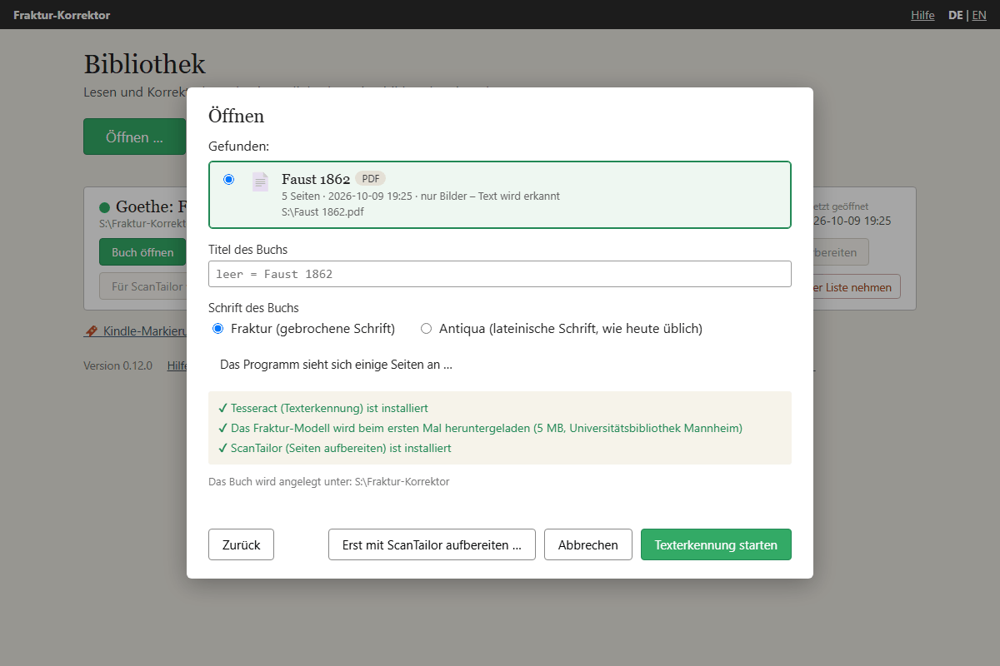
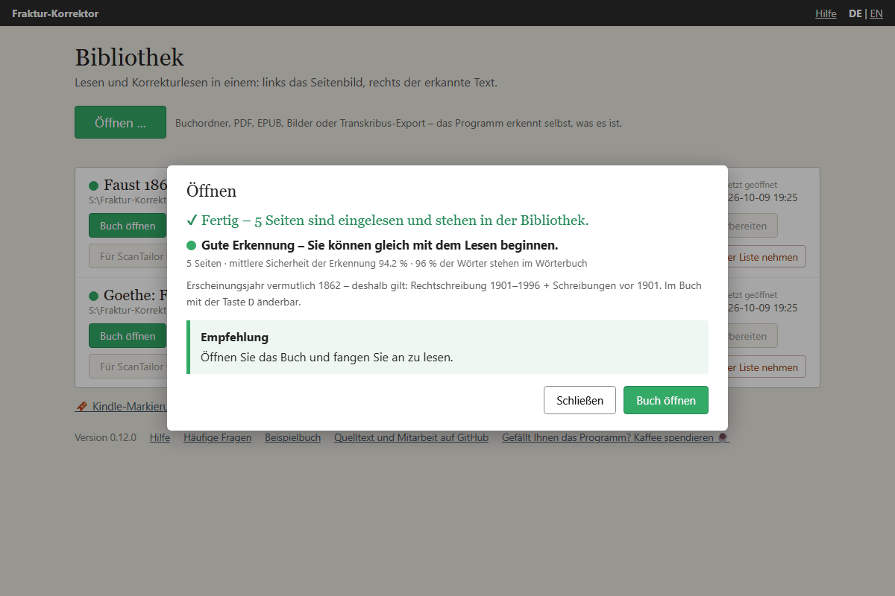

# PDF oder Bilder einlesen

*Stand: 9. Oktober 2026 (Fraktur-Korrektor 0.12.0).*

Haben Sie ein Buch als gescanntes PDF oder als Ordner mit Seitenfotos, kann der Fraktur-Korrektor den Text
selbst erkennen. Er benutzt dafür das freie Programm **Tesseract**, das auf Ihrem Rechner läuft – es wird
nichts ins Internet übertragen. Unter Windows und auf dem Mac ist Tesseract im fertigen Programm enthalten. Unter
Linux und beim Start aus dem Quelltext installieren Sie es selbst: [Werkzeuge installieren](install-tools.md).

**Zum Ausprobieren** eignet sich eine gemeinfreie Ausgabe von Goethes *Faust* (Cotta, Stuttgart 1862; Fraktur,
470 Seiten, 16,5 MB): <https://archive.org/download/fausteinetragd00goetuoft/fausteinetragd00goetuoft.pdf>.
Sie bringt schon eine Textebene mit – gut, um beide Wege zu vergleichen (siehe unten).

## Der Weg im Überblick

So kommen Sie von einem gescannten PDF zu einem lesbaren Text. Die Ampel entscheidet, wie weit Sie gehen müssen:

1. **Einlesen** (nächster Abschnitt). Tesseract erkennt den Text, wenige Sekunden je Seite.
2. **Ampel ansehen.** Grün: fertig – lesen und korrigieren. Gelb oder Rot: *nicht* gleich von Hand korrigieren,
   sondern zuerst die Vorlage verbessern. Das ist fast immer schneller als tausend Einzelkorrekturen.
3. **Scans vorbereiten** – eingebaut, ohne weiteres Programm: Doppelseiten teilen, geraderichten, dunkle Ränder
   und Finger entfernen. Danach **erneut erkennen** lassen. Meist reicht das.
4. **ScanTailor** – ein eigenes Programm, nur wenn die Seiten zum Bund hin gewölbt sind, Flecken mitten im Text
   liegen oder das Licht ungleichmäßig ist. Gewölbte Seiten meldet das Programm selbst („die Zeilenenden sind
   viel schlechter als der Rest“). Danach erneut erkennen lassen.
5. Bleibt die Ampel auf Gelb oder Rot, ist die Vorlage für Tesseract zu schwer: dann [Transkribus](transkribus.md)
   – mit denselben vorbereiteten Bildern, die Arbeit aus Schritt 3 und 4 ist nicht verloren.

**Erneut erkennen** heißt immer: die verbesserten Seitenbilder als neues Buch einlesen. Das Programm führt Sie
dorthin – nach *Scans vorbereiten* ist der Ordner mit den vorbereiteten Seiten schon ausgewählt, nach ScanTailor
schon eingetragen; Sie klicken nur noch auf **Texterkennung starten**. Das neue Buch steht neben dem alten in der
Bibliothek. Das alte bleibt, bis Sie es mit **Aus der Liste nehmen** entfernen (die Dateien bleiben dabei auf
der Festplatte). Sie können also gefahrlos vergleichen. Ist nur eine einzelne Seite misslungen, genügt
**Seite ersetzen …** in der Leseansicht: Sie zeigen dem Programm eine neue Aufnahme, und nur diese Seite wird neu
erkannt – siehe [Bedienung](usage.md).

Welche anderen Programme es gibt und wofür sie taugen, steht unter [Andere Programme im Vergleich](vergleich.md).

**Was dahinter steckt** (Stand 9. Oktober 2026): Tesseract ist eine freie Texterkennung, die Google lange
gepflegt hat und die heute eine offene Gemeinschaft weiterentwickelt; aktuelle Fassung 5.5.3 vom Juli 2026
(<https://github.com/tesseract-ocr/tesseract/releases>), und diese Fassung steckt auch im fertigen Programm. Für
Fraktur benutzt der Fraktur-Korrektor das Modell **frak2021** der Universitätsbibliothek Mannheim, das an vielen
historischen Drucken trainiert wurde (<https://github.com/UB-Mannheim/tesseract/wiki>). Ist nur ein älteres
Fraktur-Modell installiert (`deu_latf`, `deu_frak`, `frk` oder `Fraktur` aus dem Tesseract-Projekt), lädt er frak2021
beim ersten Einlesen dazu; ohne Internetverbindung nimmt er das ältere. Für Antiqua nimmt er das Standardmodell `deu`; fehlt es, frak2021, das auch Antiqua lesen kann.
Einzelheiten: [Werkzeuge installieren](install-tools.md).

## So geht es

1. In der Bibliothek auf **Öffnen …** klicken und das PDF (**Datei wählen …**) oder den Ordner mit den Seitenbildern
   (**Ordner wählen …**) zeigen. Das Programm erkennt selbst, was es vor sich hat – siehe [Ein Buch öffnen](add-book.md).
2. Das Fenster zeigt, ob Tesseract vorhanden ist und welches Fraktur-Modell benutzt wird. Fehlt das Modell, lädt
   das Programm es beim ersten Einlesen selbst herunter (5 MB, von der Universitätsbibliothek Mannheim).
3. Titel eintragen (leer gelassen, nimmt das Programm den Namen der Datei) und die **Schrift des Buchs** wählen:
   *Fraktur* oder *Antiqua* (lateinische Schrift, wie heute üblich).
4. **Texterkennung starten.** Ein Balken zeigt den Fortschritt („Seite 12 von 470 erkannt“); rechnen Sie mit
   wenigen Sekunden je Seite. Mit **Abbrechen** lässt sich der Vorgang jederzeit stoppen; dann wird nichts angelegt.
   Mehr als 999 Seiten nimmt das Programm nicht an – teilen Sie ein so dickes Buch vorher.

## Durchsuchbare PDFs: Text übernehmen

Viele PDFs sind schon „durchsuchbar“: Ein anderes Programm (ABBYY FineReader, OCRmyPDF, der Scanner selbst) hat
den Text bereits erkannt und unsichtbar hinter das Seitenbild gelegt. Der Fraktur-Korrektor bemerkt das
(„Dieses PDF ist schon durchsuchbar …“) und bietet zwei Wege an:

- **Text übernehmen (dauert nur Sekunden)** – auch bei mehreren hundert Seiten. Die Seitenbilder werden
  unverändert aus dem PDF genommen. Tesseract wird dafür nicht gebraucht.
- **Text mit Tesseract neu erkennen** – sinnvoll, wenn der vorhandene Text schlecht ist, zum Beispiel weil ein
  Frakturbuch mit einem Programm für lateinische Schrift erkannt wurde.

Im Zweifel erst übernehmen und die Ampel ansehen. Ist sie gelb oder rot, steht unter der Empfehlung der Knopf
**Text neu erkennen lassen**: Er verwirft das eben Eingelesene und lässt Tesseract dasselbe PDF neu erkennen. Bei
Rot ist er schon hervorgehoben.

Stammt das PDF aus einer Bibliothek und enthält keinen Text, lohnt ein Blick auf deren Seiten: Oft liegt der
erkannte Text dort getrennt vom PDF bereit (hOCR oder ALTO) und lässt sich nachträglich über das Buch legen –
siehe [Text aus einer Bibliothek](add-book.md).

## Die Ampel

Nach der Erkennung schätzt das Programm, wie gut das Ergebnis ist. Es benutzt dafür zwei Werte, die unter der
Ampel stehen: die **mittlere Sicherheit der Erkennung** (wie sicher sich Tesseract bei den Wörtern war) und wie viel
Prozent der Wörter **im Wörterbuch stehen**. Gezählt wird der mittlere Wert über alle Seiten; Seiten mit weniger als
20 Wörtern (Titelblatt, Abbildungen) zählen nicht mit.

| Ampel | Sicherheit der Erkennung | Wörter im Wörterbuch | Bedeutung | Was tun? |
|---|---|---|---|---|
| 🟢 grün | mindestens 85 % | **und** mindestens 88 % | Gute Erkennung, etwa so gut wie Transkribus. | Einfach lesen und korrigieren. |
| 🟡 gelb | dazwischen | dazwischen | Brauchbar, aber mit vielen Lesefehlern. | Für ein paar Seiten in Ordnung. Für ein ganzes Buch erst die Vorlage verbessern (siehe unten), sonst [Transkribus](transkribus.md). |
| 🔴 rot | unter 75 % | **oder** unter 78 % | Schlechte Erkennung. | Nicht von Hand korrigieren – erst die Vorlage verbessern (*Scans vorbereiten*, siehe unten) oder [Transkribus](transkribus.md) benutzen. |

Bei Text, der aus dem PDF übernommen wurde, zählt nur das Wörterbuch – ein PDF speichert nicht, wie sicher die
Erkennung war: grün ab 88 %, rot unter 78 %.

Unter der Ampel steht außerdem, wenn nötig:

- **Seiten mit besonders vielen Fehlern** – Seiten mit einer Sicherheit unter 75 % oder weniger als 78 % bekannten
  Wörtern. Sind es nur wenige, ersetzen Sie sie einzeln (**Seite ersetzen …** in der Leseansicht).
- **„Auf … Seiten sind die Zeilenenden viel schlechter als der Rest“** – dort ist die Erkennung am Zeilenende um
  mindestens 10 Prozentpunkte unsicherer als in der Zeilenmitte. Der Hinweis erscheint, wenn mindestens ein Viertel
  der Seiten so aussieht. Fast immer ist die Seite dann zum Bund hin gewölbt: ein Fall für ScanTailor (siehe unten).

Der farbige Punkt erscheint auch in der Bibliothek vor dem Buchtitel. Die Werte jeder einzelnen Seite stehen
in der Datei `qualitaet.json` im Buchordner.

## Doppelseiten, schiefe Seiten, dunkle Ränder: Scans vorbereiten

Texterkennung ist nur so gut wie das Bild. Wer ein Buch im Lesesaal abfotografiert, hat meist **zwei Buchseiten
auf einem Bild**, die Seiten liegen **schief**, und am Rand sind **Tischplatte, Buchkante oder ein Finger** mit
im Bild. Alles drei erledigt das Programm selbst, bevor es den Text erkennt.

**Vor dem ersten Einlesen:**

1. Über **Öffnen …** das PDF oder den Ordner mit den Fotos zeigen. Das Programm sieht sich einige Seiten an.
   Stehen zwei Seiten nebeneinander, liegen sie schief oder läuft ein dunkler Rand an der Seite entlang, erscheint
   als Empfehlung der Knopf **Scans vorbereiten …**. Sehen die Seiten gut aus, steht dort „Die Seiten sehen gut
   aus“ und daneben **Trotzdem vorbereiten …**.
2. Darauf klicken. Sie sehen die erste Doppelseite mit einer **roten Linie**. Steht sie in der Bundmitte? Sonst
   ziehen Sie sie mit der Maus dorthin oder verschieben sie mit den Pfeiltasten `←` `→` (mit `Umschalt` in
   größeren Schritten). Die Linie gilt für alle Seiten; auf jeder einzelnen sucht das Programm die Falz noch einmal
   in der Nähe und passt die Linie an. Drei Häkchen sagen, was geschehen soll: **Doppelseiten an der Linie
   teilen**, **Schiefe Seiten geraderichten** – dahinter steht der gemessene Winkel – und **Dunkle Ränder und
   Finger entfernen**. Bei diesem Häkchen zeigt ein **grün gestrichelter Kasten** auf der Vorschau, was von der
   gezeigten Seite bleibt; auf jeder anderen Seite misst das Programm neu.
3. **Übernehmen.** Ein Balken zeigt den Fortschritt; rechnen Sie mit wenigen Sekunden je Seite. Die
   vorbereiteten Seiten kommen in einen eigenen Ordner `aufbereitet` im Buchordner; Ihre Vorlage bleibt unverändert.
   Aus jeder Doppelseite werden zwei Seiten, linke zuerst. Gedreht wird erst ab 0,3° Schieflage; gemessen wird bis
   5° – was schiefer liegt, ist falsch fotografiert und sollte neu aufgenommen werden.
   Abgeschnitten wird nur, was deutlich dunkler als das Papier ist und am Bildrand liegt – nie der Text selbst:
   Um den Textblock bleibt immer ein Sicherheitsabstand. Ein Finger, der von unten oder von der Seite hereinragt,
   wird weiß übermalt; ragt er bis an den Text, bleibt dieses Stück stehen, damit keine Buchstaben verloren
   gehen. Ein Schatten, der über die halbe Seite reicht, wird in Ruhe gelassen. Bei Fotos vom Lesesaal-Tisch lohnt
   sich ein Blick auf ein paar vorbereitete Seiten; ist der Schnitt zu knapp oder zu großzügig, lassen Sie die
   Vorlage ohne das Häkchen noch einmal vorbereiten.
4. **Erneut erkennen:** Danach ist der neue Ordner schon ausgewählt – auf **Texterkennung starten** klicken. Das
   Programm merkt sich, dass die Seiten vorbereitet wurden (Kennzeichen *vorbereitet* in der Bibliothek).

**Liegt das Buch schon in Ihrer Bibliothek** – etwa weil Sie es erst einmal so haben erkennen lassen und die Ampel
gelb oder rot zeigt –, steht beim Buch der Knopf **Scans vorbereiten**. Er zeigt dieselbe Vorschau und bereitet die
Seitenbilder des Buchs auf. Anschließend klicken Sie auf **Text erkennen lassen …**: Das Fenster *Öffnen* erscheint
mit den vorbereiteten Seiten, und **Texterkennung starten** legt ein neues Buch an; das bisherige bleibt, wie es ist.

**Einfacher ist es, gar keine Doppelseiten zu fotografieren.** Jede Seite einzeln und bildfüllend, die Kamera
parallel zur Seite, gleichmäßiges Licht – dann bleibt dem Programm nichts zu teilen und wenig zu drehen. Wie das im
Lesesaal gelingt, auch mit dem iPhone: [Bücher selbst fotografieren](fotografieren.md).

## Gewölbte Seiten, Flecken, ungleichmäßiges Licht: ScanTailor

Was das Programm nicht kann: gewölbte Seiten entzerren, Flecken mitten auf der Seite entfernen, ungleichmäßige
Ausleuchtung ausgleichen. Meldet es, dass **die Zeilenenden viel schlechter sind als der Rest**, ist die Seite
zum Bund hin gewölbt. Dafür gibt es das freie Programm **ScanTailor Advanced** ([Installation](install-tools.md)
– auf dem Mac nur mit Umständen). Es trennt auch Doppelseiten und richtet gerade, nur eben mit mehr Handarbeit.

Ist ScanTailor installiert, findet der Fraktur-Korrektor es selbst; sonst zeigen Sie es ihm einmal mit
**Programm zeigen …** (siehe [Werkzeuge installieren](install-tools.md)).

**Für ein PDF, das noch nicht eingelesen ist:**

1. Über **Öffnen …** das PDF wählen und im Fenster unten auf **Erst mit ScanTailor aufbereiten …** klicken.
   Das Programm speichert jede PDF-Seite als Bild in einen Ordner `scantailor` im künftigen Buchordner
   (ScanTailor kann keine PDFs öffnen) und startet ScanTailor.
2. In ScanTailor: **Neues Projekt …**. Als *Eingabeverzeichnis* den Ordner angeben, der auf `scantailor` endet.
   Abtippen müssen Sie ihn nicht: Der Fraktur-Korrektor legt den Pfad in die Zwischenablage (in das Feld
   klicken und mit `Strg`+`V`, auf dem Mac `⌘`+`V` einfügen) und öffnet den Ordner zusätzlich im Dateifenster, von
   wo Sie ihn hineinziehen können. Das *Ausgabeverzeichnis* `out` schlägt ScanTailor selbst vor – beibehalten.
3. Die sechs Schritte links von oben nach unten durchgehen: *Ausrichtung korrigieren* → *Seiten teilen* →
   *Geraderichten* → *Inhalt auswählen* → *Ränder* → *Ausgabe*. Meist genügt es, in jedem Schritt auf das Dreieck
   ▶ neben dem Namen des Schritts zu klicken (*Stapelverarbeitung starten* – das bearbeitet alle Seiten) und das
   Ergebnis durchzublättern. Im Schritt *Ausgabe* für Fraktur: 600 DPI, Modus *Schwarz und Weiß*; bei gewölbten
   Seiten dort *Entzerren* auf *Automatisch* stellen.
4. **Erneut erkennen:** Zurück im Fraktur-Korrektor auf **Zurück** und **Untersuchen** klicken – der Ordner
   `…/scantailor/out` ist schon eingetragen – und dann auf **Texterkennung starten**. Haben Sie das Fenster
   zwischendurch geschlossen, finden Sie den Ordner über **Öffnen …** → **Ordner wählen …**; er heißt `out` und
   liegt im Buchordner unter `scantailor`. Das Programm weist ihn als *Ergebnis von ScanTailor* aus.

   Wichtig: Nur wenn Sie **dieses** Ergebnis einlesen, arbeiten Sie mit den bearbeiteten Seiten weiter. Lesen Sie
   erneut das PDF ein, war die ganze Mühe umsonst.

**Für einen Ordner mit Fotos** braucht es den Zwischenschritt nicht: ScanTailor selbst starten und den Fotoordner
als Eingabeverzeichnis angeben. Den Ordner `out`, den ScanTailor darin anlegt, lesen Sie danach über **Öffnen …**
→ **Ordner wählen …** ein. Lassen Sie den Titel leer, heißt das Buch wie der Fotoordner.

**Liegt das Buch schon in Ihrer Bibliothek**, steht beim Buch der Knopf **Für ScanTailor vorbereiten**. Er legt
eine Kopie der Seitenbilder in den Ordner `scantailor` des Buchs, gibt diesen Eingabeordner in die Zwischenablage
und startet ScanTailor. Als Ausgabeordner schlägt ScanTailor dann selbst `…/scantailor/out` vor – den lassen Sie
stehen. Ist ScanTailor fertig, lesen Sie das Ergebnis mit **Öffnen …** als
neues Buch ein (den Buchordner oder `…/scantailor/out` wählen) und klicken auf **Texterkennung starten**.

Wollen Sie den Text lieber von [Transkribus](transkribus.md) lesen lassen, laden Sie dort die Dateien aus
`…/scantailor/out` bzw. `…/aufbereitet` hoch – Transkribus trennt Doppelseiten nämlich nicht.

## Zweispaltiger Satz

Zeitungen und Lexika sind meist in zwei Spalten gesetzt. Das Programm erkennt das an der Lage der Zeilen und liest
spaltenweise: erst die linke Spalte von oben nach unten, dann die rechte. Eine Überschrift über beide Spalten
kommt davor; steht unter den Spalten wieder Text über die ganze Breite, folgt er danach. Kurze Fußnoten, die zu
zweit nebeneinanderstehen, bleiben zeilenweise – so sind sie durchnummeriert.

Grenzen: Drei und mehr Spalten, Tabellen und Verzeichnisse mit Seitenzahlen am rechten Rand werden weiter Zeile
für Zeile gelesen; im Zweifel ändert das Programm die Reihenfolge lieber nicht. Hat Tesseract zwei Spalten zu einer
Zeile zusammengezogen, kann das Programm sie nicht mehr trennen. Stimmt die Reihenfolge einer Seite nicht, gibt es
in der Leseansicht keinen Griff, um Zeilen zu verschieben – lassen Sie die Seite dann von
[Transkribus](transkribus.md) lesen: Dort lässt sich jede Spalte als eigener Bereich anlegen, und der Export
ersetzt den Text der Seite.
