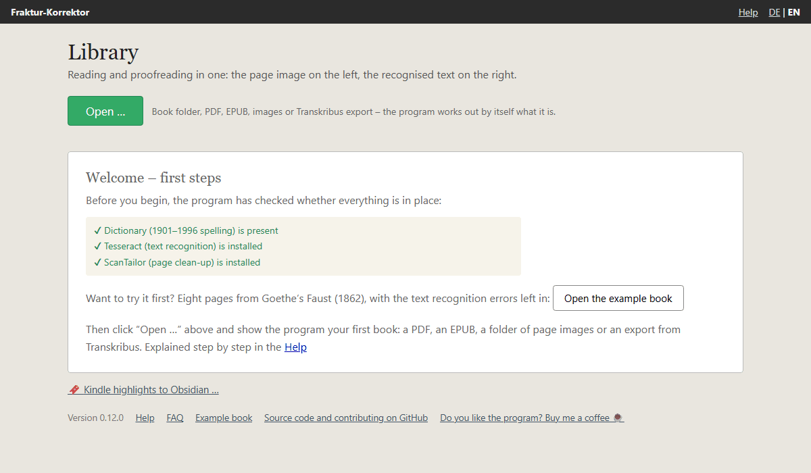
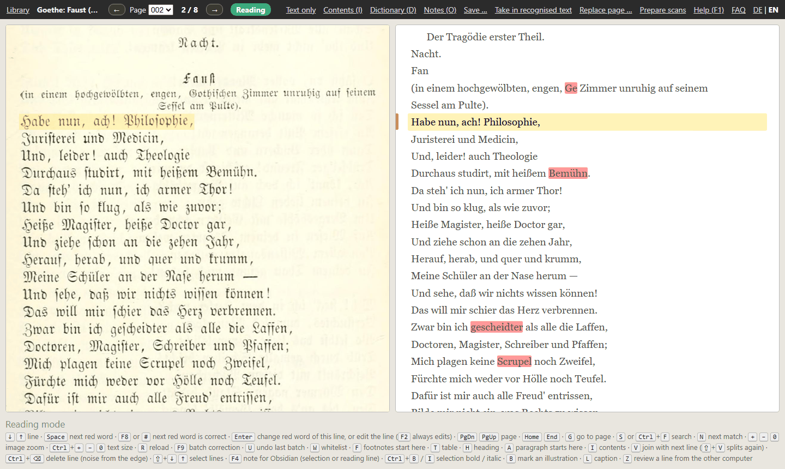
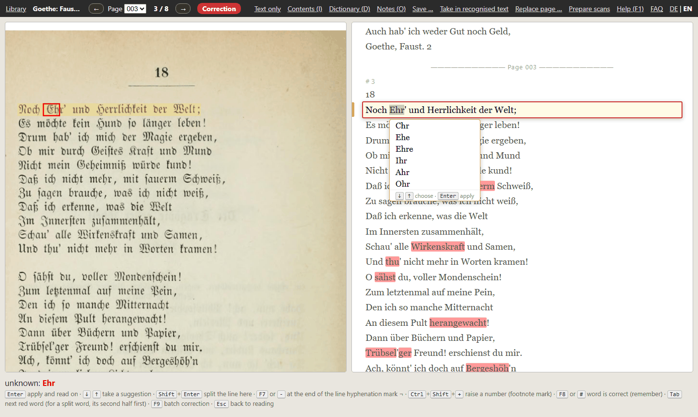

# First steps

This page takes you through the essentials in ten minutes – using an example book that comes with the program. You
don't need a book of your own for it, and you can't break anything.

## Opening the example book

On first start the library shows a welcome. The program has already checked that everything it needs is in place –
three green ticks. Below them is the button **Open the example book**.

The example book is eight pages from Goethe's *Faust* in an 1862 edition: the title page, the beginning of the
monologue “Habe nun, ach! Philosophie …” and three pages of prose. The text is exactly as the text recognition
delivered it – mistakes included. The program puts a copy into your books folder; whatever you change only affects
that copy. Later you will find the example book in the library again, and the link **Example book** is always at
the bottom of the library.

## What you see

- **On the left the page image**, as the book was printed.
- **On the right the text** that the text recognition made of it.
- **The yellow reading line** is on the same line in both halves. Image and text move together as you read on.
- **Red words** are not in the dictionary. That does not always mean they are wrong – more on that in a moment.
- **At the bottom** are the keys that apply right now, so you don't have to memorise anything.
- **In the bar at the top** you see which state the program is in: **Reading** (green) or **Correction** (red).

## Reading

Press `↓` and the reading line moves down one line; `↑` goes back. The mouse wheel does the same, and clicking a line
makes it the reading line. At the end of a page the text simply continues on the next one. To turn whole pages, use
`PgDn` and `PgUp`.

## Correcting a red word

Press `Space`. The program jumps to the next red word, and the indicator at the top turns red:
**Correction**. The line becomes an input field, the word is selected, and in the page image it is framed in red – so
you see at a glance what is really printed there.

Now you have three choices:

1. **The word was misread.** Simply type the right word – it replaces the selected one. Or pick one of the
   suggestions below with `↓`. `Enter` accepts the correction. That already saves it; there is no save button.
2. **The word is right**, the dictionary just doesn't know it – a name, a technical term, an old spelling. Press
   `F8`. The program remembers the word for this book and no longer marks it red anywhere.
3. **You want to look at it later.** `Esc` cancels without changing anything.

The picture above shows case 2: “Ehr'” is Goethe's short form of “Ehre” (honour), so it is right – `F8`. The page
before has a real mistake: the text recognition turned “gothischen” into “Ge”. Try it there.

After `Enter` or `F8` the program is back in reading mode – unless there is another red word in the same line, which
then comes next. The next `Space` takes you to the next red word. That is how you work through a book:
`Space`, look, correct or `F8`, on.

## What is not red

The dictionary only finds words it doesn't know. If a word has turned into a different, correct word, it stays
black – in the example book page 2 has “Fan” instead of “Faust.” near the top. You notice such mistakes while
reading. Then press `F2`: the whole reading line becomes an input field and you can change anything in it,
punctuation too. `Enter` accepts.

## The ten most important keys

| Key | Effect |
|---|---|
| `↓` `↑` | next / previous line |
| `PgDn` `PgUp` | next / previous page |
| `Space` | to the next red word |
| `↓` (while correcting) | put a suggestion into the field |
| `Enter` | accept the correction |
| `F8` | the word is right – remember it |
| `Esc` | cancel without changing |
| `F2` | edit the reading line freely |
| `S` | search the whole book |
| `F1` | help |

All the keys and everything else you can do – footnotes, headings, the same correction across the whole book at
once, notes for Obsidian – are described under [Usage](usage.md).

## Your own book

The way back to the library is at the top left. There you click **Open …** and show the program your book: a PDF,
an EPUB, a folder of page images or an export from Transkribus. What happens then is described under
[Opening a book](add-book.md) and [Reading in a PDF or images](pdf-import.md).

Afterwards you can keep the example book or take it out of the library with **Remove from list**; the copy then
stays in your books folder, and a click on **Example book** brings it back.
