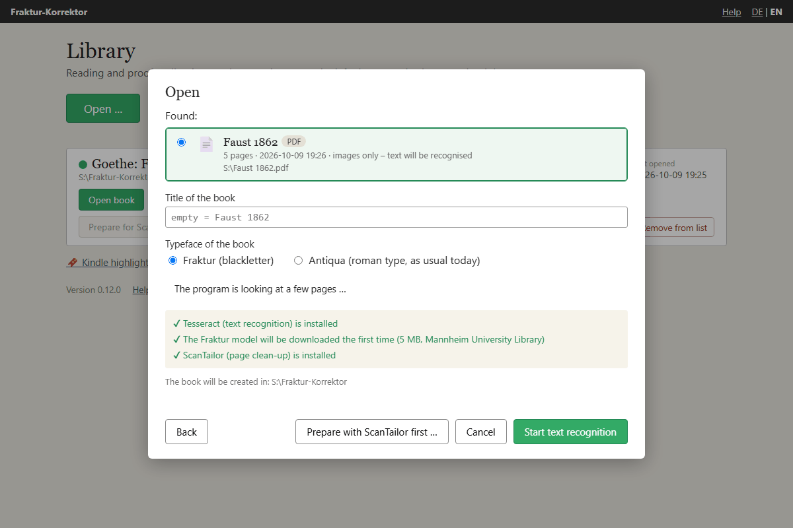
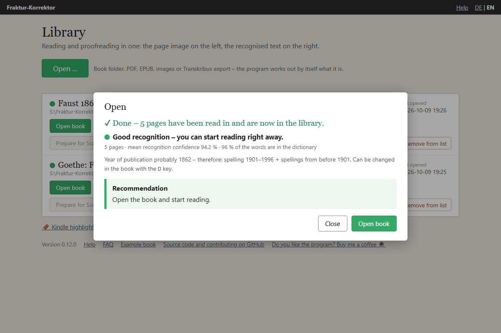

# Reading in a PDF or images

*As of 9 October 2026 (Fraktur-Korrektor 0.12.0).*

If you have a book as a scanned PDF or as a folder of page photos, Fraktur-Korrektor can recognise the text
itself. It uses the free program **Tesseract**, which runs on your own computer – nothing is sent to the
internet. On Windows and on the Mac, Tesseract comes with the finished program. On Linux, and if you start from
the source code, you install it yourself: [Installing the tools](install-tools.md).

**To try it out**, take a public-domain edition of Goethe's *Faust* (Cotta, Stuttgart 1862; Fraktur, 470 pages,
16.5 MB): <https://archive.org/download/fausteinetragd00goetuoft/fausteinetragd00goetuoft.pdf>. It already
carries a text layer, which makes it a good way to compare both routes (see below).

## The route at a glance

This is how you get from a scanned PDF to readable text. The traffic light decides how far you have to go:

1. **Read it in** (next section). Tesseract recognises the text, a few seconds per page.
2. **Look at the traffic light.** Green: done – read and correct. Yellow or red: do *not* start correcting by hand;
   improve the scan first. That is almost always faster than a thousand single corrections.
3. **Prepare the scans** – built in, no other program needed: split double pages, straighten, remove dark
   margins and fingers. Then have the text **recognised again**. Usually that is enough.
4. **ScanTailor** – a separate program, only if the pages curve towards the binding, there are stains in the
   middle of the text or the lighting is uneven. The program reports curved pages itself (“the line ends are
   much worse than the rest”). Then have the text recognised again.
5. If the traffic light stays yellow or red, the scan is too hard for Tesseract: then [Transkribus](transkribus.md)
   – with the same prepared images, so the work of steps 3 and 4 is not lost.

**Recognising again** always means: reading in the improved page images as a new book. The program takes you
there – after *Prepare scans* the folder with the prepared pages is already selected, after ScanTailor it is
already entered; all you do is click **Start text recognition**. The new book appears next to the old one in the
library. The old one stays until you remove it with **Remove from list** (the files stay on the disk). So you can
compare without risk. If only a single page went wrong, **Replace page …** in the reading view is enough: you show
the program a new capture, and only that page is recognised again – see [Usage](usage.md).

For what else is available, see [Other programs compared](vergleich.md).

**What is behind it** (as of 9 October 2026): Tesseract is a free text recognition engine that Google
maintained for years and that an open community develops today; current version 5.5.3 of July 2026
(<https://github.com/tesseract-ocr/tesseract/releases>), and this is also the version in the finished program.
For Fraktur, Fraktur-Korrektor uses the model **frak2021** of Mannheim University Library, trained on many
historical prints (<https://github.com/UB-Mannheim/tesseract/wiki>). If only an older Fraktur
model is installed (`deu_latf`, `deu_frak`, `frk` or `Fraktur` from the Tesseract project), it downloads frak2021 the
first time you read in a book; without an internet connection it uses the older one. For
Antiqua it uses the standard model `deu`; if that is missing, frak2021, which can read Antiqua too.
Details: [Installing the tools](install-tools.md).

## How to do it

1. In the library, click **Open …** and show the PDF (**Choose file …**) or the folder with the page images
   (**Choose folder …**). The program works out by itself what it is – see [Opening a book](add-book.md).
2. The window shows whether Tesseract is available and which Fraktur model will be used. If the model is
   missing, the program downloads it by itself the first time you read in a book (5 MB, from Mannheim University
   Library).
3. Enter a title (left empty, the program uses the file name) and choose the **typeface of the book**:
   *Fraktur* (blackletter) or *Antiqua* (roman type, as usual today).
4. **Start text recognition.** A bar shows the progress (“Page 12 of 470 recognised”); expect a few seconds per
   page. **Stop** cancels at any time; nothing is created then. The program does not take more than 999 pages –
   split a book that thick beforehand.

## Searchable PDFs: using the existing text

Many PDFs are already “searchable”: another program (ABBYY FineReader, OCRmyPDF, the scanner itself) has recognised
the text and placed it invisibly behind the page image. Fraktur-Korrektor notices this (“This PDF is already
searchable …”) and offers two routes:

- **Use this text (takes only seconds)** – even for several hundred pages. The page images are taken from the
  PDF unchanged. Tesseract is not needed for this.
- **Recognise the text afresh with Tesseract** – sensible if the existing text is poor, for example because a
  Fraktur book was recognised by a program made for roman type.

If in doubt, use the text first and look at the traffic light. If it is yellow or red, the button **Recognise
text afresh** appears below the recommendation: it discards what was just read in and has Tesseract recognise the
same PDF afresh. With red it is already highlighted.

If the PDF comes from a library and contains no text, have a look at the library’s site: the recognised text
is often available there separately from the PDF (hOCR or ALTO) and can be laid over the book afterwards –
see [Text from a library](add-book.md).

## The traffic light

After recognition the program estimates how good the result is. It uses two figures, shown below the light: the
**mean recognition confidence** (how sure Tesseract was about the words) and what percentage of the words **are
in the dictionary**. It takes the middle value over all pages; pages with fewer than 20 words (title page,
illustrations) do not count.

| Light | Recognition confidence | Words in the dictionary | Meaning | What to do |
|---|---|---|---|---|
| 🟢 green | at least 85 % | **and** at least 88 % | Good recognition, roughly as good as Transkribus. | Just read and correct. |
| 🟡 yellow | in between | in between | Usable, but with many misreadings. | Fine for a few pages. For a whole book, improve the scan first (see below), otherwise [Transkribus](transkribus.md). |
| 🔴 red | below 75 % | **or** below 78 % | Poor recognition. | Do not correct this by hand – improve the scan first (*Prepare scans*, see below) or use [Transkribus](transkribus.md). |

For text taken from the PDF only the dictionary counts – a PDF does not store how confident the recognition was:
green from 88 %, red below 78 %.

Below the light the program also shows, where needed:

- **Pages with especially many errors** – pages with a confidence below 75 % or fewer than 78 % known words. If
  there are only a few, replace them one by one (**Replace page …** in the reading view).
- **“On … pages the line ends are much worse than the rest”** – there, recognition at the end of the line is at
  least 10 percentage points less confident than in the middle of the line. The note appears when at least a
  quarter of the pages look like this. Almost always the page then curves towards the gutter: a case for
  ScanTailor (see below).

The coloured dot also appears in the library in front of the book title. The values for every single page
are stored in the file `qualitaet.json` in the book folder.

## Double pages, crooked pages, dark margins: preparing the scans

Text recognition is only as good as the image. Anyone photographing a book in a reading room usually ends up
with **two book pages on one picture**, the pages are **crooked**, and **the table top, the book’s edge or a
finger** is in the picture at the margin. The program handles all three itself before it recognises the text.

**Before the first read-in:**

1. Via **Open …** point at the PDF or the folder of photos. The program looks at a few pages. If two pages sit
   side by side, the pages are crooked or a dark margin runs along the page, the button **Prepare scans …**
   appears as the recommendation. If the pages look fine, it says “The pages look fine” and offers
   **Prepare anyway …**.
2. Click it. You see the first double page with a **red line**. Is it in the middle of the gutter? If not, drag
   it there with the mouse or move it with the arrow keys `←` `→` (with `Shift` in bigger steps). The line
   applies to all pages; on each one the program looks for the gutter again nearby and adjusts the line. Three
   check boxes say what is to happen: **Split double pages at the line**, **Straighten crooked pages** – the
   measured angle is shown after it – and **Remove dark margins and fingers**. With this box ticked, a **green
   dashed box** on the preview shows what remains of the page shown; every other page is measured afresh.
3. **Apply.** A bar shows the progress; expect a few seconds per page. The prepared pages go into a folder of
   their own, `aufbereitet`, inside the book folder; your original stays untouched. Every double page becomes
   two pages, the left one first. Pages are only rotated from 0.3° of skew; the program measures up to 5° –
   anything more crooked was photographed wrongly and should be taken again.
   Only what is clearly darker than the paper and lies at the edge of the picture is cut off – never the text
   itself: a safety margin always remains around the text block. A finger reaching in from below or from the side
   is painted white; if it reaches the text, that part is left as it is so that no letters are lost. A shadow
   covering half the page is left alone. With photos taken on a reading-room table it is worth looking at a few
   prepared pages; if the cut is too tight or too generous, prepare the original again without the tick.
4. **Recognise again:** afterwards the new folder is already selected – click **Start text recognition**. The
   program remembers that the pages were prepared (tag *prepared* in the library).

**If the book is already in your library** – say, because you had it recognised as it was at first and the light
shows yellow or red –, the book has a button **Prepare scans**. It shows the same preview and prepares the book’s
page images. Then click **Recognise the text …**: the *Open* window appears with the prepared pages, and **Start
text recognition** creates a new book; the present one stays as it is.

**Easier still: do not photograph double pages at all.** Every page on its own and filling the picture, the camera
parallel to the page, even light – then the program has nothing to split and little to rotate. How to manage that
in a reading room, iPhone included: [Photographing books yourself](fotografieren.md).

## Curved pages, stains, uneven light: ScanTailor

What the program cannot do: flatten curved pages, remove stains in the middle of the page, even out uneven lighting. If
it reports that **the line ends are much worse than the rest**, the page curves towards the gutter. For that
there is the free program **ScanTailor Advanced** ([Installation](install-tools.md) – awkward on the Mac). It
splits double pages and deskews too, just with more manual work.

If ScanTailor is installed, Fraktur-Korrektor finds it by itself; otherwise show it once with
**Show me the program …** (see [Installing the tools](install-tools.md)).

**For a PDF that has not been read in yet:**

1. Choose the PDF via **Open …** and click **Prepare with ScanTailor first …** at the bottom of the window.
   The program saves every PDF page as an image in a folder `scantailor` inside the future book folder
   (ScanTailor cannot open PDFs) and starts ScanTailor.
2. In ScanTailor: **New Project …**. As *Input Directory*, give the folder ending in `scantailor`. You do not
   have to type it: Fraktur-Korrektor puts the path on the clipboard (click the field and paste with `Ctrl`+`V`,
   on the Mac `⌘`+`V`) and also opens the folder in a file window, from where you can drag it in. ScanTailor
   suggests the *Output Directory* `out` itself – keep it.
3. Work through the six stages on the left from top to bottom: *Fix Orientation* → *Split Pages* → *Deskew* →
   *Select Content* → *Margins* → *Output*. Usually it is enough to click the triangle ▶ next to the name of each
   stage (*Launch batch processing* – this processes all pages) and to leaf through the result. In the *Output*
   stage, for Fraktur: 600 DPI, mode *Black and White*; for curved pages set *Dewarping* there to *Auto*.
4. **Recognise again:** back in Fraktur-Korrektor, click **Back** and **Examine** – the folder
   `…/scantailor/out` is already entered – and then **Start text recognition**. If you closed the window in
   between, find the folder through **Open …** → **Choose folder …**; it is called `out` and sits inside the book
   folder under `scantailor`. The program labels it *output of ScanTailor*.

   Important: only if you read in **this** result do you carry on with the processed pages. Read the PDF in
   again and all the effort was for nothing.

**For a folder of photos** the intermediate step is not needed: start ScanTailor yourself and give the photo
folder as input directory. Afterwards read in the folder `out` that ScanTailor creates inside it, through
**Open …** → **Choose folder …**. If you leave the title empty, the book is named after the photo folder.

**If the book is already in your library**, it has a button **Prepare for ScanTailor**. It puts a
copy of the page images into the book’s folder `scantailor`, places this input folder on the clipboard and starts
ScanTailor. ScanTailor then suggests `…/scantailor/out` as output folder by itself – leave it as it is. When ScanTailor has finished, read in the result as a new book with **Open …** (choose the
book folder or `…/scantailor/out`) and click **Start text recognition**.

If you would rather have [Transkribus](transkribus.md) read the text, upload the files from
`…/scantailor/out` or `…/aufbereitet` there – Transkribus does not split double pages.

## Two-column layouts

Newspapers and encyclopaedias are usually set in two columns. The program recognises this from the position of
the lines and reads column by column: first the left column from top to bottom, then the right one. A heading
across both columns comes first; text across the full width below the columns follows afterwards. Short footnotes
that stand side by side stay line by line – that is how they are numbered.

Limits: three or more columns, tables and lists with page numbers at the right margin are still read line by line;
when in doubt, the program leaves the order alone. Where Tesseract has merged two columns into one line, the
program cannot separate them any more. If the order of a page is wrong, the reading view has no handle for moving
lines – have the page read by [Transkribus](transkribus.md) instead: there each column can be marked as its own
region, and the export replaces the text of the page.
